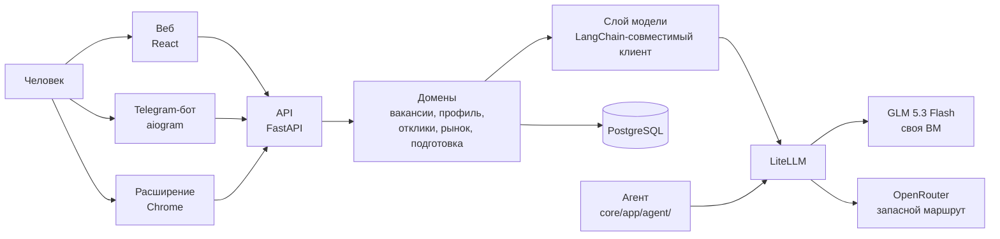

# Агент поиска удалённой работы за рубежом

Человек формулирует цель словами: «хочу удалённую работу backend-разработчиком, живу в
Москве, переезжаю в Сербию, B2B подходит». Агент ищет вакансии, проверяет правила страны и
условия найма и отправляет отклик только после подтверждения человеком.

| Сайт | Бот |
|---|---|
| <https://rnd-cdn-relay.xyz> | `@BBX_fan_bot` |

## Архитектура



- `api/` — HTTP, вход по токену из бота, фоновые задачи.
- `core/` — логика по доменам; правила слоёв проверяет import-linter.
- `core/app/agent/` — агент: граф, инструменты поверх продукта, пределы, чекпойнты.
- `frontend/`, `bot_app/`, `extension/` — интерфейсы.
- `deploy/` — Compose, Caddy, скрипт деплоя, релей OpenRouter.

## Агент: инструменты с контрактами поверх продукта

Агент работает на данных продукта: резюме и собранные вакансии — из базы аккаунта, письмо и
очередь откликов — через сценарии продукта. Контракт каждого инструмента описан по полям
семинара: имя, описание, аргументы, что берётся не от модели, результат, ошибки, тип, отказ.
Примеры из набора (`core/app/agent/tools.py`):

| Поле | `search_vacancies` | `read_work_terms` | `queue_application` |
|---|---|---|---|
| Имя | найти вакансии | прочитать условия найма | поставить отклик в очередь на подтверждение |
| Описание | что возвращает, когда звать, когда не звать | условия вакансии с цитатами из текста: занятость, гео, часы, валюта | действие: карточка человеку, после «да» текст уходит в вакансию, вакансия — в очередь автооткликов |
| Аргументы | `query`, `work_format` (enum), `min_overall_score` (0–100) | `vacancy_id` (только из поиска) | `vacancy_id` (только из поиска), `cover_note` (40–600 символов) |
| Не от модели | ничего: фильтры задаёт модель | аккаунт берётся из сессии | отправитель и «да» человека берутся из сессии |
| Результат | до 5 записей, `total`, `shown`, `hint` при обрезке | поля условий + цитаты | `submission_id`, вакансия, бакет очереди |
| Ошибки | `validation`, `timeout`, `unavailable` | `validation`, `not_found` | `validation`, `not_found`, `timeout` |
| Тип | чтение, повтор разрешён | чтение, повтор разрешён | действие, повтора нет без ключа идемпотентности |
| Отказ | вернуть ошибку модели с подсказкой | вернуть ошибку модели | без «да» человека возвращается `cancelled` |

Остальные инструменты того же набора: `read_profile` (резюме и международный потенциал),
`score_vacancy` (оценка 0–100 по профилю), `write_cover_letter` (письмо и сохранение в карточку).
Инструменты правил страны (K-1), калькулятора (K-3) и памяти (M-1) добавятся вместе с их
модулями. На каждый инструмент — тест на демо-данных (`tests/test_agent_tools.py`, `demo-101…`).

Как устроен агент (`core/app/agent/graph.py`, deepagents над LangGraph):

1. Узел «план» (planner) разбивает цель на 3–6 шагов, узел «шаг» исполняет шаг маленьким ReAct
   от deepagents (модели не отдаются built-in инструменты платформы, только контракты продукта).
2. Если в ответе шага есть вызовы — код проверяет аргументы по Pydantic-схеме, для действия
   спрашивает человека и показывает карточку с конкретными параметрами.
3. Результат или ошибка уходят в контекст как обычное сообщение; ошибка — это данные
   (`type`, `message`, `hint`), граф не падает.
4. Узел «проверка» отмечает шаг по критерию, узел «перестройка» продолжает план или собирает
   его заново. Ограничения в коде: лимиты шагов/перестроек/вызовов модели (`RunLimits`) —
   выход за предел даёт честный частичный результат, а не обрыв.
5. Журнал: наблюдения шагов (инструменты, сводки, ошибки, вакансии) — в состоянии, чекпойнты —
   MemorySaver в тестах и Postgres в API (шаг A-3).
6. Расход (E-9): колбэк `RunBudget` считает вызовы модели, токены и цену по всему запуску,
   включая вызовы внутри шага, субагентов, судью и LLM внутри инструментов. Снимок едет в
   событиях узлов и в итоге (`agent_runs.usage`), а каждый вызов пишется в `llm_usage` с номером
   запуска (`agent_run_id`). По этой колонке итог запуска сверяется с независимым журналом
   вызовов. На экране, в правой панели, видно: шаги N из 8, вызовы модели N из 40, токены и
   цена. Цена GLM на нашей ВМ условная, по прайсу OpenRouter, и подписана отдельно от того,
   что оплачено в OpenRouter.

Субагенты шага (A-8, OQ-28): исполнитель может делегировать работу инструментом `task` —
исследователю страны (факты о стране с цитатами) и оценщику вакансий (балл, рекомендация
и ловушки с цитатами). Оба — basic/low с коротким промптом и структурированным возвратом
(Pydantic), лимит — 2 вызова `task` на шаг; третий отклоняется сообщением-данными. Вызовы
модели субагентов считает тот же бюджет запуска, их инструменты видны в ленте запуска с
тегом субагента.

Живой прогон — вкладка «Агент» в вебе; модель берётся из тех же фич реестра
(`agent_plan`/`agent_step`/`agent_replan` и субагенты `agent_sub_*`), что и весь продукт: серверный провайдер или личный
ключ. Провайдер меняется только конфигом продукта. Офлайн-проверка графа и инструментов —
тесты на демо-данных (без сети и ключа): см. «Проверка агента» в «Запуске».

## Модель и провайдеры

По умолчанию аккаунт пользуется серверной моделью: GLM 5.3 Flash на своей ВМ, доступ — через LiteLLM
на стенде (`deploy/litellm/config.yaml`). Ключ модели и адрес живут только в окружении стенда.
Свой ключ OpenRouter человек может вставить на странице «Аккаунт» и включить тумблером — тогда
запросы идут через его ключ и его счёт. Без серверного провайдера личный ключ остаётся основным
путём, как в обычной установке продукта.

Запасной маршрут — OpenRouter через Render-релей: со стенда OpenRouter отвечает 403, потому что
блокирует регион, поэтому запрос идёт через отдельный сервис с фиксированным регионом.

Переменные окружения (полный список — `deploy/.env.example`):

| Переменная | Что задаёт |
|---|---|
| `SERVER_LLM_BASE_URL`, `SERVER_LLM_API_KEY` | адрес и ключ серверного провайдера (LiteLLM) |
| `MODEL_SERVER_ADVANCED`, `MODEL_SERVER_BASIC`, `MODEL_SERVER_RESERVE` | имена моделей на серверном провайдере по тирам |
| `OPENROUTER_BASE_URL`, `OPENROUTER_API_KEY` | прямой OpenRouter или релей для запасного маршрута |
| `MODEL_TIER_ADVANCED`, `MODEL_TIER_BASIC`, `MODEL_TIER_RESERVE` | модели OpenRouter для личного ключа |
| `MODEL_PRICES`, `SELF_HOSTED_MODELS` | прайс моделей без цены в ответе и список моделей своей ВМ, чья цена на экране условная |

## Надёжность и безопасность: что уже есть

- Действия (отклик) по умолчанию выполняются только после подтверждения человеком; карточка
  показывает конкретные параметры, фраза модели «клиент согласен» подтверждением не считается.
  Ответов три: «да», «изменить текст» (человек правит письмо перед «да»; вакансию правкой не
  подменить) и «нет». Режим «подтверждать автоматически» включает сам пользователь у поля ввода
  (`PUT /api/agent/settings`); он фиксируется на старте запуска, а каждое действие без вопроса
  остаётся событием с параметрами в ленте запуска.
- Лимит шагов и защита от повторяющихся вызовов — в коде, а не в промпте.
- Ошибка инструмента возвращается модели как данные (`type`, `message`, `hint`), агент не падает.
- Аргументы проверяются по схеме; клиент и его данные берутся из сессии, а не из текста модели.
- Ключи только в переменных окружения; в репозитории лежит `deploy/.env.example` без значений.
- В продукте — изоляция данных аккаунтов на уровне PostgreSQL (RLS) и учёт стоимости вызовов.

Чего пока нет: защита от prompt injection в данных инструментов
с демонстрацией атаки, eval-набор из 15 сценариев с LLM-судьёй, отчёт с метриками.

## Оценка качества

Eval-набора пока нет: он в работе. Токены и цена уже собираются: каждый вызов модели пишется в
`llm_usage` с номером запуска, итог запуска — в `agent_runs.usage`. Трассировка LangSmith
включается переменными `LANGSMITH_*`; на стенде она выключена. Набор будет состоять из
сценариев «цель → ожидаемое поведение», прогоняться несколько раз (модель недетерминирована), а
судья будет проверять, есть ли у вывода цитата из данных. Сравнение — агент против обычного чата
на тех же сценариях.

## Запуск

Нужны Docker и [uv](https://docs.astral.sh/uv/). Node 24 нужен только для фронта и расширения.

```bash
# 1. Скопировать настройки и вписать ключ провайдера модели в .env
cp deploy/.env.example .env

# 2. Поднять базу и приложение
docker compose -f deploy/compose.yaml up -d postgres api frontend

# 3. Создать таблицы в базе
docker compose -f deploy/compose.yaml run --rm -T api \
  uv run --no-sync python -m core.platform.db.migrate
```

Сайт откроется на <http://localhost:5173>. Пока токен входа ни разу не выпускался, сайт пускает
без Telegram.

Проверки, как в CI:

```bash
uv sync
uv run ruff check . && uv run ruff format --check && uv run pyright && uv run lint-imports
uv run pytest
(cd frontend && npm ci && npm run typecheck && npm run lint && npm run test)
(cd extension && npm ci && npm test)
```

Проверка агента (тесты не ходят в сеть):

```bash
uv run pytest tests/test_agent_toolkit.py tests/test_agent_tools.py tests/test_agent_graph.py
```

## Репозиторий

| Папка | Что внутри |
|---|---|
| `core/app/agent/` | агент: контракты и инструменты поверх продукта, граф plan/step/check/replan на deepagents, пределы, чекпойнты |
| `api/` | FastAPI: HTTP и поток событий |
| `core/` | домены продукта, слой модели, доступ к БД |
| `frontend/` | веб: React, Vite, shadcn |
| `extension/` | расширение Chrome |
| `bot_app/` | Telegram-бот |
| `deploy/` | Compose, Caddy, деплой, LiteLLM, релей OpenRouter |
| `prompts/` | промпты модели |
| `tests/` | тесты бэкенда, в том числе агента |
| `USER_GUIDE.md` | руководство пользователя продукта |